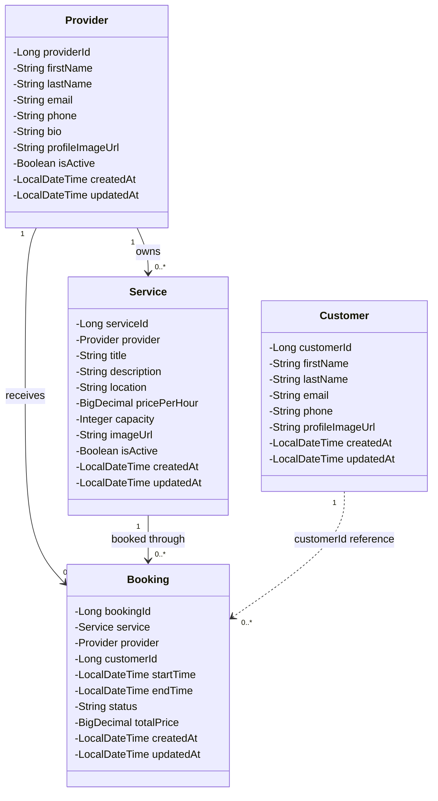

## Customer API

Implemented by Caleb James.

Base URL for local testing: `http://localhost:8080`

| Method | Endpoint | Purpose | Success | Errors |
|---|---|---|---|---|
| POST | `/api/customers` | Create a customer profile | 201 Created | 400 invalid input |
| GET | `/api/customers` | Get all customers | 200 OK | — |
| GET | `/api/customers/{id}` | Get a customer by ID | 200 OK | 404 not found |
| PUT | `/api/customers/{id}` | Update a customer profile | 200 OK | 400 invalid input; 404 not found |
| DELETE | `/api/customers/{id}` | Delete a customer | 204 No Content | 404 not found |
| GET | `/api/bookings?customerId={id}` | Get bookings for a customer | 200 OK | — |

It returns an empty array when no bookings match the customer ID.

### Create Customer

Send a POST request to `/api/customers` with this JSON body:

```json
{
  "firstName": "Caleb",
  "lastName": "James",
  "email": "caleb@example.com",
  "phone": "3365550100",
  "profileImageUrl": ""
}
```

The server generates the customer ID and timestamps. First name, last name, and email are required. Email must have a valid format.

### Update Customer

Send a PUT request to `/api/customers/{id}` with this JSON body:

```json
{
  "firstName": "Caleb",
  "lastName": "James",
  "email": "caleb@example.com",
  "phone": "3365550199",
  "profileImageUrl": ""
}
```

### Customer Booking History

Send a GET request to:

```text
/api/bookings?customerId=1
```

Each matching booking includes its status, start and end times, total price, studio listing, and provider.

Cancellation through `DELETE /api/bookings/{id}` changes the booking status to `CANCELLED` and retains the booking in the customer's history.

### Manual Verification

Tested locally using Bruno and a Neon PostgreSQL development database:

- Created a customer: 201 Created.
- Retrieved and updated a customer: 200 OK.
- Retrieved a missing customer: 404 Not Found.
- Submitted an invalid customer: 400 Bad Request.
- Deleted a test customer: 204 No Content; subsequent retrieval returned 404.
- Retrieved customer 1's booking with studio and provider details.
- Queried a customer ID with no matching bookings and received an empty array.
- Cancelled a booking and verified its status changed to CANCELLED.
- Restarted the app and verified the cancelled booking remained available.


---

## Provider, Studio Listing, and Booking APIs

Implemented by Clay Hyka.

Live backend URL: https://f26-team14-backend.onrender.com


### Provider API

Implemented by Clay Hyka.

| Method | Endpoint | Use Case / Purpose | Success Status | Implemented By |
|---|---|---|---|---|
| POST | `/api/providers` | Create a provider profile | 201 Created | Clay Hyka |
| GET | `/api/providers` | View all providers | 200 OK | Clay Hyka |
| GET | `/api/providers/{id}` | View a provider profile | 200 OK | Clay Hyka |
| PUT | `/api/providers/{id}` | Update a provider profile | 200 OK | Clay Hyka |
| DELETE | `/api/providers/{id}` | Delete a provider profile | 204 No Content | Clay Hyka |

#### Create Provider — POST /api/providers

Example JSON request:

{
  "firstName": "John",
  "lastName": "Smith",
  "email": "john.smith@example.com",
  "phone": "3365551234",
  "bio": "Studio owner offering creative spaces.",
  "profileImageUrl": "https://example.com/profile.jpg",
  "isActive": true
}

#### Update Provider — PUT /api/providers/{id}

Example JSON request:

{
  "firstName": "John",
  "lastName": "Smith",
  "email": "john.updated@example.com",
  "phone": "3365559999",
  "bio": "Experienced studio owner offering photography spaces.",
  "profileImageUrl": "https://example.com/profile.jpg",
  "isActive": true
}


### Studio Listing API

Implemented by Clay Hyka.

| Method | Endpoint | Use Case / Purpose | Success Status | Implemented By |
|---|---|---|---|---|
| POST | `/api/services` | Create a studio listing | 201 Created | Clay Hyka |
| GET | `/api/services` | View available studio listings | 200 OK | Clay Hyka |
| GET | `/api/services/{id}` | View a specific studio listing | 200 OK | Clay Hyka |
| PUT | `/api/services/{id}` | Update a studio listing | 200 OK | Clay Hyka |
| DELETE | `/api/services/{id}` | Delete a studio listing | 204 No Content | Clay Hyka |

#### Create Studio Listing — POST /api/services

Example JSON request:

```json
{
  "title": "Downtown Photography Studio",
  "description": "Creative studio space available for photography and video shoots.",
  "location": "Greensboro, NC",
  "pricePerHour": 75.00,
  "capacity": 10,
  "imageUrl": "https://example.com/studio.jpg",
  "isActive": true,
  "provider": {
    "providerId": 1
  }
}
```

#### Update Studio Listing — PUT /api/services/{id}

Example JSON request:

```json
{
  "title": "Updated Downtown Photography Studio",
  "description": "Renovated studio space for photography and video shoots.",
  "location": "Greensboro, NC",
  "pricePerHour": 85.00,
  "capacity": 12,
  "imageUrl": "https://example.com/studio.jpg",
  "isActive": true,
  "provider": {
    "providerId": 1
  }
}
```


### Booking API

Implemented by Clay Hyka, with customer booking history functionality added by Caleb James.

| Method | Endpoint | Use Case / Purpose | Success Status | Implemented By |
|---|---|---|---|---|
| POST | `/api/bookings` | Create a studio booking | 201 Created | Clay Hyka |
| GET | `/api/bookings` | View bookings | 200 OK | Clay Hyka |
| GET | `/api/bookings/{id}` | View a specific booking | 200 OK | Clay Hyka |
| GET | `/api/bookings?customerId={id}` | View a customer's booking history | 200 OK | Caleb James |
| DELETE | `/api/bookings/{id}` | Cancel a booking by changing its status to CANCELLED | 204 No Content | Clay Hyka / Caleb James |

#### Create Booking — POST /api/bookings

Example JSON request:

{
  "service": {
    "serviceId": 1
  },
  "provider": {
    "providerId": 1
  },
  "customerId": 1,
  "startTime": "2026-10-26T10:00:00",
  "endTime": "2026-10-26T12:00:00",
  "totalPrice": 170.00
}

#### Customer Booking History — GET /api/bookings?customerId=1

Returns bookings associated with the specified customer. An empty array is returned when no bookings match.

#### Cancel Booking — DELETE /api/bookings/{id}

Changes the booking status to CANCELLED while retaining the booking in the customer's history.


## UML Class Diagram

The following diagram shows the main entities and relationships in the Studio Share backend.


